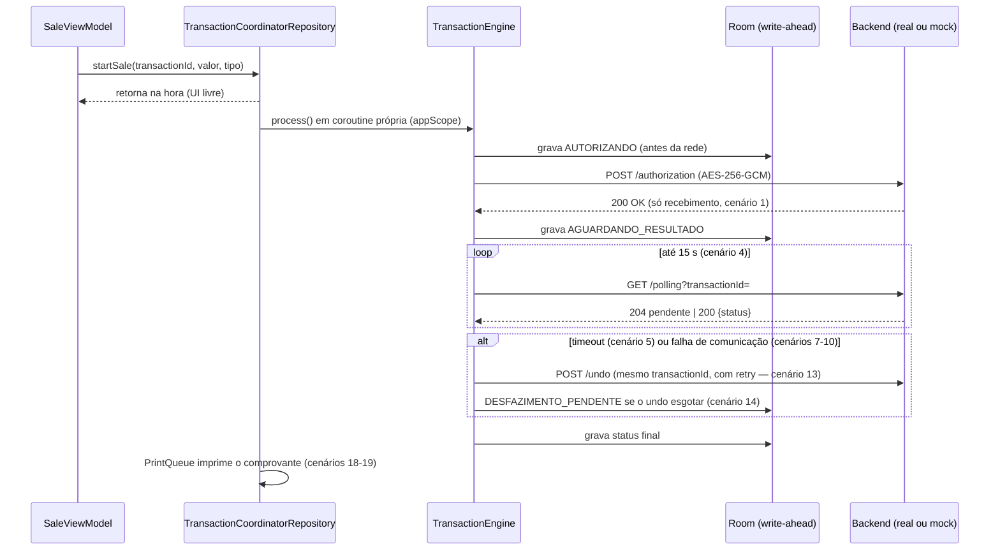

# SmartPOS: fluxo de venda assíncrono

Solução do desafio técnico de Desenvolvedor(a) Kotlin (SmartPOS): um app Android
em Clean Architecture + MVVM que envia vendas a um backend de forma
assíncrona (autorização → polling → timeout/desfazimento), com AES-256-GCM
sobre HTTPS, idempotência por `transactionId` e impressão de comprovantes
conforme as transações terminam — sem nunca travar a UI.

## Como rodar

```bash
# Android Studio Ladybug+ (JDK 17), compileSdk 37, emulador API 24+
./gradlew installMockDebug        # instala no emulador/POS com o backend mockado
./gradlew testDebugUnitTest       # testes de unidade (JVM, sem emulador) dos dois flavors
./gradlew pixel2api30DebugAndroidTest           # testes instrumentados de core/feature (Gradle Managed Device)
./gradlew :app:connectedMockDebugAndroidTest    # E2E do :app (precisa de emulador/dispositivo já conectado)
```

Não existe backend real para configurar: o flavor `mock` roda o backend
**dentro do próprio processo do app**, como um `Interceptor` do OkHttp (ver
ADR-0006). Os comprovantes "impressos" aparecem no Logcat (tag
`SmartPOS-Printer`) e na tela de Detalhe, em **Ver comprovante**.

### Cenários de demonstração (escolhidos pelos centavos do valor)

| Centavos | Exemplo | O que o mock faz | Resultado esperado no POS |
|---|---|---|---|
| qualquer outro | R$ 10,00 | Aprova entre 1,5 s e 6 s | **APROVADA** |
| `,13` | R$ 10,13 | Rejeita | **REJEITADA** |
| `,20` | R$ 10,20 | Nunca responde | timeout de 15 s → `/undo` → **DESFEITA** (TEMPO ESGOTADO) |
| `,50` | R$ 10,50 | Recebe e aprova, mas a resposta do `/authorization` se perde | `/undo` → **DESFEITA** (FALHA DE COMUNICACAO) |
| `,66` | R$ 10,66 | Rede cai a partir do 2º polling | `/undo` → **DESFEITA** (FALHA DE COMUNICACAO) |
| `,77` | R$ 10,77 | Nunca responde e o `/undo` falha 2 vezes | timeout → `/undo` com retry → **DESFEITA** |

Para ver a concorrência, dispare várias vendas seguidas (ex.: R$ 10,20,
depois R$ 5,00, depois R$ 7,13). A Home volta na hora depois de "Pagar" e
mostra todas em andamento ao mesmo tempo; os comprovantes saem na ordem em
que cada uma termina — exatamente o que `SmartPosE2ETest.duas_vendas_concorrentes_nao_bloqueiam_a_ui`
verifica no emulador.

## Por que Jetpack Compose

Resumo (razão completa em [ADR-0002](docs/adr/0002-jetpack-compose.md)): as
telas são função de um estado que muda sozinho em background (uma venda
avança sem nenhum toque do operador), e Compose + `StateFlow` +
`collectAsStateWithLifecycle()` modela isso diretamente, sem
Adapter/`DiffUtil` manual e com testes de semântica em vez de Espresso.

## Árvore de módulos

```
:app                          monta Hilt (incl. módulos por flavor), NavHost, StartupGate

core:model, core:common       Kotlin puro (jvm) — sem Android, sem Hilt
core:domain                   Kotlin puro (jvm) — TransactionEngine, casos de uso, interfaces
core:testing                  fakes/fixtures compartilhados (jvm, só testImplementation)

core:security                 AES-256-GCM, KeyProvider (estático no mock / Keystore em prod)
core:network                  HttpPaymentGateway (OkHttp + HTTPS + envelope cifrado)
core:network-mock             backend simulado (Interceptor OkHttp) — só no flavor `mock`
core:local-storage            Room (TransactionDao/Event) + DataStore (preferências)
core:data                     TransactionCoordinatorRepository, RoomTransactionJournal, Worker
core:printer                  ReceiptPrinter simulada + PrintQueue (fila serial)
core:ui                       design system Compose (tema "Petróleo", PosButton, StatusChip...)

feature:home                  tela inicial, lista + banner de pendência
feature:sale                  tela de venda (teclado numérico próprio)
feature:transaction-detail    detalhe + linha do tempo técnica
feature:transactions          lista com filtros
feature:pendings              desfazimentos pendentes + "tentar agora"
feature:receipt               comprovante + reimpressão
feature:more                  menu (sem ViewModel, tela estática)
feature:blocking              tela de bloqueio (terminal/chave inválidos)
```

Regras de dependência (fiscalizadas por revisão de código, não por lint de
Gradle — ver [ADR-0001](docs/adr/0001-modularizacao-por-camada-e-feature.md)):
`core:model`/`core:domain` nunca dependem de Android; nenhum `feature:*`
depende de outro `feature:*` nem de `core:data`/`core:network`/`core:local-storage`
diretamente — só de `core:domain` e `core:ui`.

## Arquitetura e fluxo de uma transação



Estados de `TransactionStatus` (`core:model`):

```
CRIADA → AUTORIZANDO → AGUARDANDO_RESULTADO ─┬─→ APROVADA
                                              ├─→ REJEITADA
                                              └─→ DESFAZENDO → DESFEITA
                                                            └→ DESFAZIMENTO_PENDENTE (retry via WorkManager)
```

- **`core:domain/engine/TransactionEngine`** processa **uma** transação:
  `EngineConfig` define os prazos (`resultTimeoutMs = 15_000`,
  `initialPollDelayMs = 500`, `pollIntervalMs = 1_000`,
  `undoMaxAttempts = 3`, `undoRetryBaseDelayMs = 1_000`).
- **`core:data/repository/TransactionCoordinatorRepository`** orquestra
  **várias** transações em paralelo (uma coroutine por venda, no
  `appScope`) e é a única fonte de verdade da UI (Flow do Room — ver
  [ADR-0004](docs/adr/0004-room-como-fonte-unica-de-verdade.md)).
- **`core:data/worker/PendingUndoWorkScheduler`** garante que um `/undo`
  pendente seja retentado mesmo com o app fechado (ver
  [ADR-0005](docs/adr/0005-workmanager-para-retry-de-desfazimento.md)).

## Como cada requisito foi atendido

| Requisito | Módulo / classe | Como |
|---|---|---|
| Home com "Vender", lista de transações | `feature:home` | `HomeScreen` + `HomeViewModel`, Flow do repositório |
| Tela de venda (valor, Débito/Crédito, Pagar) | `feature:sale` | Teclado numérico próprio (`core:ui/NumericKeypad`), valor em centavos |
| UI nunca trava / várias transações simultâneas | `TransactionCoordinatorRepository` | Cada venda roda em coroutine própria no `appScope` (`SupervisorJob`); `SaleViewModel.onPayClick` retorna na hora |
| `transactionId` único e idempotente | `SaleViewModel`, `TransactionEngine`, `MockBackend` | UUID gerado uma única vez por venda (toque duplo reenvia o mesmo id); o backend trata payload repetido como no-op e payload diferente como 409 |
| HTTPS | `HttpPaymentGateway`, `network_security_config.xml` | `require(baseUrl.isHttps)`; cleartext proibido no manifest |
| AES-256 adicional no corpo | `core:security` | AES-256-**GCM** com AAD — ver [ADR-0003](docs/adr/0003-aes-256-gcm-sobre-https.md) |
| `/authorization` só confirma recebimento | `TransactionEngine.process` | 200 move para `AGUARDANDO_RESULTADO`, sem interpretar resultado |
| Resultado via polling | `TransactionEngine.awaitFinalStatus` | 1º polling após 500 ms, depois a cada 1 s, até status final |
| Timeout de 15 s → `/undo` | `withTimeoutOrNull(EngineConfig.resultTimeoutMs)` | Cobre todo o fluxo, inclusive uma `/authorization` lenta |
| Falha de comunicação → sempre `/undo` | `CommunicationException` | Qualquer erro de rede, HTTP não-2xx, decriptação ou resposta inconsistente |
| Impressão conforme processamento | `core:printer/PrintQueue` | Fila serial, retry em falha de impressora, reimpressão sob demanda |
| Comprovante com transactionId, valor, status | `core:model/ReceiptFormatter` | 32 colunas (bobina 58 mm) |
| Resiliência (app morto, retry) | `RoomTransactionJournal`, `TransactionCoordinatorRepository.start()`, `PendingUndoWorkScheduler` | Write-ahead + recuperação + WorkManager |

## Tabela de cenários → testes

Os 23 cenários do desafio, na ordem numerada, e onde cada um é verificado
(todos passam — ver "Qualidade" abaixo para como reproduzir):

| # | Cenário | Teste(s) |
|---|---|---|
| 1 | Venda aprovada | `TransactionEngineTest.aprovada apos alguns pollings - sem undo`, `GatewayWithMockBackendTest.fluxo aprovado...`, `SmartPosE2ETest.venda_aprovada_mostra_status_e_comprovante` |
| 2 | Venda rejeitada | `TransactionEngineTest.rejeitada - sem undo` |
| 3 | Backend informa DESFEITA diretamente | `TransactionEngineTest.backend informa DESFEITA - nao chama undo de novo` |
| 4 | Aguardando resultado (polling pendente) | `TransactionEngineTest.aguardando resultado antes do polling final`, `HttpPaymentGatewayTest.polling 204 retorna null (pendente)` |
| 5 | Timeout de 15 s | `TransactionEngineTest.sem resultado em 15s - desfaz exatamente aos 15s`, `SmartPosE2ETest.venda_sem_resposta_desfaz_apos_timeout` (~16 s reais, no emulador) |
| 6 | Authorization lenta conta no prazo | `TransactionEngineTest.authorization lento tambem conta no prazo de 15s` |
| 7 | Falha de rede no `/authorization` (envio) | `TransactionEngineTest.falha de rede no authorization - desfaz` |
| 8 | Resposta do `/authorization` perdida | `TransactionEngineTest.resposta do authorization perdida...`, `GatewayWithMockBackendTest.resposta perdida do authorization - undo garante DESFEITA no backend` |
| 9 | Falha de rede no polling | `TransactionEngineTest.falha de rede no polling - desfaz` |
| 10 | Erro HTTP (não-2xx) | `HttpPaymentGatewayTest.authorization com http de erro lanca CommunicationException` |
| 11 | Resposta de polling inconsistente (outra transação/valor) | `TransactionEngineTest.resposta de polling de outra transacao ou valor - desfaz` |
| 12 | Bloqueio de venda offline | `HomeViewModelTest.vender offline mostra snackbar e nao navega` |
| 13 | Retry do `/undo` (falha 2x, confirma na 3ª) | `TransactionEngineTest.undo falha duas vezes e funciona na terceira` |
| 14 | Esgotamento do `/undo` (fica pendente) | `TransactionEngineTest.undo nunca confirma - fica DESFAZIMENTO_PENDENTE`, `PendingsViewModelTest.mostra apenas transacoes com desfazimento pendente` |
| 15 | Recuperação após app morto (transação órfã) | `TransactionCoordinatorRepositoryTest.recuperacaoAoAbrirDesfazTransacaoOrfa` (emulador real) |
| 16 | Vendas concorrentes | `TransactionCoordinatorRepositoryTest.vendasSimultaneasTerminamIndependentemente`, `SmartPosE2ETest.duas_vendas_concorrentes_nao_bloqueiam_a_ui` |
| 17 | Toque duplo / idempotência | `TransactionCoordinatorRepositoryTest.idDuplicadoDoTequeDuploEhIgnorado`, `SaleViewModelTest.toque duplo em pagar gera uma unica transacao`, `TransactionEngineTest.mesmo transactionId e payload...`, `GatewayWithMockBackendTest.authorization repetida nao duplica...` |
| 18 | Falha de impressora com retry | `PrintQueueTest.falha de impressora tem retry e cada transacao imprime uma unica vez` |
| 19 | Impressora esgota tentativas / reimpressão | `PrintQueueTest.impressora sem papel esgota as tentativas...`, `PrintQueueTest.reimpressao gera nova via mesmo apos sucesso`, `ReceiptViewModelTest.reimprimir chama o use case e avisa` |
| 20 | Venda incompleta (validação) | `SaleViewModelTest.venda incompleta desabilita pagar e toque avisa o motivo` |
| 21 | Valor no limite | `SaleViewModelTest.valor no limite bloqueia mais digitos e avisa` |
| 22 | Terminal mal configurado | `ValidateTerminalUseCaseTest`, `StartupViewModelTest.merchantId invalido bloqueia com TERMINAL_NOT_CONFIGURED` |
| 23 | Chave de segurança inválida | `StartupViewModelTest.chave de criptografia que falha bloqueia com INVALID_SECURITY_KEY` |

## Segurança

Ver [ADR-0003](docs/adr/0003-aes-256-gcm-sobre-https.md) para a decisão
completa. Resumo do envelope:

```json
POST /authorization
X-Transaction-Id: <uuid>
Idempotency-Key: <uuid>
X-Payload-Encryption: A256GCM

{ "kid": "dev-key-01", "alg": "A256GCM", "iv": "<12 bytes b64>", "data": "<ciphertext+tag b64>" }
```

- IV aleatório (96 bits) por mensagem, nunca reutilizado.
- AAD (`"<método> <path>|<transactionId>"`) amarra o ciphertext ao endpoint
  e à transação — um corpo de `/authorization` não decifra se reenviado
  para `/undo` ou associado a outro id.
- A resposta do `/polling` também é cifrada e autenticada.
- **Flavor `mock`:** chave AES-256 fixa de **desenvolvimento**, hardcoded no
  `BuildConfig` só desse flavor e compartilhada com o backend simulado —
  nunca compila no flavor `prod` (confirmado abaixo, em "Qualidade").
- **Flavor `prod`:** `AndroidKeystoreKeyProvider` — a chave é gerada e vive
  só no Android Keystore (`AndroidKeyStore`, modo GCM, não exportável),
  nunca existe em texto claro no processo do app.
- `allowBackup="false"` no manifest; nenhum log de payload/chave em
  release.

## Premissas adotadas

1. **Polling pendente = HTTP 204.** O contrato só define a resposta com
   status final; enquanto não há resultado o backend responde
   `204 No Content`.
2. **`amount` em centavos (inteiro).** Evita erro de ponto flutuante com
   dinheiro.
3. `paymentType` trafega como `"Credito"`/`"Debito"`.
4. O prazo de 15 s conta a partir do envio do `/authorization`; o `/undo`
   roda fora desse prazo e não é cancelável.
5. Um `DESFEITA` informado pelo próprio backend é final e não gera outro
   `/undo` (cenário 3).
6. O comprovante é impresso também para `REJEITADA` e `DESFEITA`
   ("conforme as transações forem sendo processadas").
7. `merchantId` (15 dígitos) e `terminalId` (8 dígitos) vêm da configuração
   do terminal e são validados no `StartupGate`, antes de qualquer venda
   ser possível (cenário 22).
8. Terminal mal configurado ou chave de criptografia inválida nunca
   crasham o app: levam à tela de bloqueio (`feature:blocking`), com
   "Tentar novamente" (cenários 22/23).

## Qualidade

```bash
./gradlew spotlessCheck detekt :app:lint   # formatação, estática, lint Android
./gradlew testDebugUnitTest                # testes de unidade, flavors mock e prod
./gradlew koverXmlReport koverVerify       # cobertura agregada (ver abaixo)
./gradlew pixel2api30DebugAndroidTest      # instrumentados de core/feature (Gradle Managed Device)
./gradlew :app:connectedMockDebugAndroidTest   # E2E do :app (emulador/dispositivo já conectado)
./gradlew :app:assembleProdRelease         # build de release do flavor prod, com R8
```

Todos os comandos acima foram executados neste repositório antes de cada
commit (ver histórico do Git) — nenhuma fase foi marcada como concluída
sem isso passar.

### Cobertura (Kover)

O `build.gradle.kts` da raiz agrega o relatório de Kover de
`core:domain/security/network/network-mock/printer` + os ViewModels de
`feature:*` + `:app` num único relatório (`./gradlew koverXmlReport`,
saída em `build/reports/kover/report.xml`). Isso importa porque um caso de
uso em `core:domain` muitas vezes só é exercitado pelo teste do ViewModel
que o consome (`feature:home` testa `ObserveTransactionsUseCase`, por
exemplo) — medir `core:domain` isolado subestimaria a cobertura real.

Os filtros excluem código gerado (Hilt, Compose, `BuildConfig`, R) e duas
classes que só funcionam com hardware real — `AndroidKeystoreKeyProvider`
(Android Keystore) e `ConnectivityManagerNetworkMonitor`
(`ConnectivityManager`) — que por isso não são exercitadas em teste de JVM;
ambas são simples o bastante para serem revisadas manualmente, e o
*comportamento* que elas expõem (chave inválida bloqueia a venda,
"vender" desabilitado offline) é coberto nos testes de
`StartupViewModelTest`/`HomeViewModelTest` com fakes.

**`core:data` fica fora do agregado:** seus próprios testes
(`TransactionCoordinatorRepositoryTest`, `TransactionDaoTest`) são
instrumentados (Room + emulador real), e o Kover, por padrão, só
instrumenta execução de testes de **JVM** — a cobertura real de
`core:data` existe, mas o Kover não a mede.

Resultado medido (não uma meta, um número real desta execução):
**92% de linhas cobertas** no relatório agregado (meta do desafio: ≥80%).
`koverVerify` falha o build se cair abaixo disso.

### Prova de que o flavor `prod` não inclui o mock

```bash
./gradlew :app:assembleProdRelease
unzip -l app/build/outputs/apk/prod/release/app-prod-release-unsigned.apk | grep -i networkmock
# (sem saída — nenhuma classe de core:network-mock no APK)
```

## Acessibilidade

- **Contraste:** os pares de cor usados em texto/ícone sobre fundo (tema
  "Petróleo", `core:ui/theme/Color.kt`) foram checados contra WCAG 2.1 —
  todos ≥ 4.5:1 (AA para texto normal), a maioria ≥ 7:1 (AAA):
  `onPrimary/primary` 7.4:1 (claro) e 7.6:1 (escuro); `onSurface/background`
  16.5:1 (claro) e 15.7:1 (escuro); os pares de `StatusChip`
  (sucesso/atenção/erro sobre seu container) entre 4.6:1 e 5.4:1.
- **Toque:** `SmartPosSizing.minTouchTarget = 48.dp` (mínimo recomendado),
  `buttonHeight`/`keyHeight = 56.dp` em `PosButton` e no teclado numérico.
- **Leitor de tela:** todo ícone decorativo tem `contentDescription = null`
  (não duplica o texto ao lado); todo elemento só-ícone tem descrição
  (`"Apagar"` no backspace do teclado, `"Mostrar/Ocultar valores"` no ícone
  de olho, `"Voltar"` na seta do topo). `StatusChip`, `ResultHeader` e
  `TransactionRow` mesclam a semântica num único nó para o TalkBack não
  ler texto duplicado em pedaços.
- **Gap encontrado e corrigido nesta fase:** `MoneyText(hidden = true)`
  renderizava o placeholder `"R$ ••••"` sem `contentDescription` — o
  TalkBack leria os bullets um a um. Corrigido para anunciar
  `"Valor oculto"` (`core/ui/component/MoneyText.kt`).
- **Toque "morto":** nenhum botão do app deixa de responder ao toque por
  estar visualmente desabilitado — `PosButton(enabled = false)` sempre
  dispara `onClick`; quem chama decide mostrar um snackbar explicando o
  motivo (regra de ouro do design system, ver `core:ui/PosButton.kt` e
  `PosButtonTest.botaoDesabilitadoContinuaRespondendoAoToque`).
- **Claro/escuro:** todas as telas usam `SmartPosTheme(darkTheme = isSystemInDarkTheme())`
  e têm `@Preview` em claro e escuro.
- **Não verificado nesta fase** (fora do escopo de tempo): navegação
  completa só por teclado físico/switch-access, e TalkBack ponta-a-ponta
  num dispositivo real fora do emulador.

## Próximos passos (fora do escopo)

- Lint de dependências entre módulos (hoje a regra "feature não depende de
  feature" é só revisão de PR — ver ADR-0001).
- Certificate pinning (`CertificatePinner`) no flavor `prod`.
- Adaptador para o SDK de impressão do fabricante (PAX, Gertec,
  Positivo…) implementando `ReceiptPrinter`.
- Testes instrumentados para `ConnectivityManagerNetworkMonitor` e
  `AndroidKeystoreKeyProvider` (hoje só revisados manualmente, ver
  "Cobertura" acima).
- TalkBack ponta-a-ponta em dispositivo real.
- Link do Figma do design system (não fornecido nesta entrega).

## ADRs

Decisões de arquitetura documentadas em [`docs/adr/`](docs/adr/):

1. [Modularização por camada e por feature](docs/adr/0001-modularizacao-por-camada-e-feature.md)
2. [Jetpack Compose em vez de Views/XML](docs/adr/0002-jetpack-compose.md)
3. [AES-256-GCM sobre HTTPS](docs/adr/0003-aes-256-gcm-sobre-https.md)
4. [Room (write-ahead) como fonte única de verdade](docs/adr/0004-room-como-fonte-unica-de-verdade.md)
5. [WorkManager para retry de desfazimento pendente](docs/adr/0005-workmanager-para-retry-de-desfazimento.md)
6. [Mock do backend como Interceptor do OkHttp](docs/adr/0006-mock-backend-como-interceptor-okhttp.md)
7. [Hilt para injeção de dependência](docs/adr/0007-hilt-para-injecao-de-dependencia.md)
