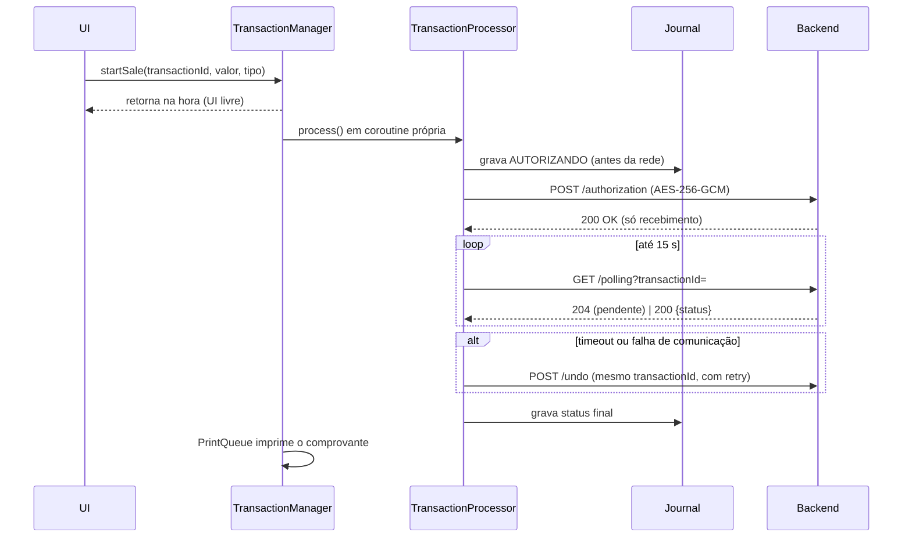

# SmartPOS: fluxo de venda assíncrono

Solução do desafio técnico de Desenvolvedor(a) Kotlin (SmartPOS): transações assíncronas com polling, timeout de 15 s e desfazimento, AES-256 no payload, idempotência por `transactionId` e impressão de comprovantes conforme as transações terminam.

## Como rodar

```bash
# Android Studio Ladybug+ (JDK 17), SDK 35
./gradlew installDebug       # instala no emulador/POS
./gradlew testDebugUnitTest  # testes unitários (JVM, sem emulador)
```

O backend vem **mockado dentro do app** (`USE_MOCK_BACKEND=true`), então não precisa de servidor. Os comprovantes "impressos" aparecem no Logcat (tag `SmartPOS-Printer`) e na Home, em **Ver comprovante**.

### Cenários de demonstração (definidos pelos centavos do valor)

| Centavos | Exemplo | O que o mock faz | Resultado esperado no POS |
|---|---|---|---|
| qualquer outro | R$ 10,00 | Aprova entre 1,5 s e 6 s | **APROVADA** |
| `,13` | R$ 10,13 | Rejeita | **REJEITADA** |
| `,20` | R$ 10,20 | Nunca responde | timeout de 15 s → `/undo` → **DESFEITA** (TEMPO ESGOTADO) |
| `,50` | R$ 10,50 | Recebe e aprova, mas a resposta do `/authorization` se perde | `/undo` → **DESFEITA** (FALHA DE COMUNICACAO) |
| `,66` | R$ 10,66 | Rede cai a partir do 2º polling | `/undo` → **DESFEITA** (FALHA DE COMUNICACAO) |
| `,77` | R$ 10,77 | Nunca responde e o `/undo` falha 2 vezes | timeout → `/undo` com retry → **DESFEITA** |

Para ver a concorrência, dispare várias vendas seguidas (por exemplo R$ 10,20, depois R$ 5,00, depois R$ 7,13). A UI nunca trava e a Home mostra todas em andamento ao mesmo tempo. Os comprovantes saem na ordem em que cada uma termina.

## Escolha da UI: Jetpack Compose

- É o toolkit recomendado hoje. A UI é declarada como função do estado (`StateFlow` → `collectAsStateWithLifecycle`), o que combina com uma lista de transações que muda de estado sozinha em background.
- Menos código e nenhum XML/adapters para a lista de transações (`LazyColumn` com `key` estável).
- Previews e um caminho direto para testes de UI.
- Custo: o APK fica um pouco maior que com Views. Em POS com pouco armazenamento isso pesaria; aqui não é relevante.

## Arquitetura

```
ui (Compose + ViewModel)
 └─ SaleLauncher / Flow<List<Transaction>>
domain
 ├─ TransactionManager   várias transações em paralelo, estado, recuperação, impressão
 └─ TransactionProcessor fluxo de UMA transação (authorize → polling → timeout/undo)
data
 ├─ remote   HttpPaymentGateway (OkHttp, HTTPS, envelope AES-256-GCM)
 ├─ crypto   AesGcmPayloadCipher, KeyProvider
 ├─ journal  registro persistente (write-ahead) das transações
 └─ mock     MockBackend + MockBackendInterceptor
printer      ReceiptPrinter, ReceiptFormatter, PrintQueue
```

- **DI manual** (`AppContainer`). O grafo é pequeno e assim o projeto não precisa de geração de código. Num produto, Hilt.
- **O mock é um `Interceptor` do OkHttp.** O cliente HTTP, a serialização e a criptografia são exatamente os que falariam com o backend real. Para trocar, basta `USE_MOCK_BACKEND=false` e apontar `API_BASE_URL`.

### Fluxo de uma transação



## Como cada requisito foi atendido

| Requisito | Onde | Como |
|---|---|---|
| UI: Home com "Vender" e tela de venda (valor, Débito/Crédito, Pagar) | `ui/home`, `ui/sale` | Compose. Valor digitado como centavos com máscara `R$`. O botão Pagar só habilita com valor > 0 e tipo escolhido |
| Não travar a UI / várias transações simultâneas | `TransactionManager` | Cada venda roda numa coroutine no escopo da aplicação (`SupervisorJob`), fora da Main. Rede via `enqueue` assíncrono. A tela de venda dispara e volta para a Home na hora |
| `transactionId` único e idempotente | `SaleViewModel`, `TransactionManager`, `MockBackend` | UUID gerado **uma vez por venda**: toque duplo não gera outra transação, e o manager ignora id repetido. O mesmo id/payload é usado em `/authorization`, `/polling` e `/undo`. Vai também nos headers `X-Transaction-Id` e `Idempotency-Key`. O backend trata repetição com mesmo payload como no-op e com payload diferente como 409 |
| HTTPS | `HttpPaymentGateway`, `network_security_config.xml` | O gateway recusa URL não-HTTPS e o app proíbe cleartext |
| AES-256 adicional no corpo | `data/crypto` | AES-256-**GCM** (ver Segurança) |
| `/authorization` só confirma recebimento | `TransactionProcessor` | 200 move a transação para `AGUARDANDO_RESULTADO`, sem interpretar resultado |
| Resultado via polling | `awaitFinalStatus` | 1º polling após 500 ms, depois a cada 1 s, até APROVADA/REJEITADA/DESFEITA |
| Timeout de 15 s → `/undo` | `withTimeoutOrNull(15_000)` | O prazo cobre **todo** o fluxo (inclusive um `/authorization` lento). Ao estourar, a chamada HTTP em curso é cancelada e o `/undo` é chamado |
| Falha de comunicação → sempre `/undo` | `CommunicationException` | Erro de rede, HTTP ≠ 2xx, corpo que não decifra e resposta de polling de outra transação ou valor: tudo vira `/undo`. Isso inclui falha no próprio `/authorization`, porque o backend pode ter recebido e só a resposta se perdeu |
| Impressão conforme processamento | `PrintQueue` | Fila serial (a impressora é um recurso único). Imprime na ordem de **conclusão**, um comprovante por transação, com retry em falha de impressora |
| Comprovante com transactionId, amount, status | `ReceiptFormatter` | 32 colunas (bobina 58 mm). Também traz EC, terminal, data, tipo e motivo do desfazimento |
| Resiliência | `TransactionJournal`, `TransactionManager.start()` | Ver abaixo |

### Resiliência além do pedido

- **Write-ahead journal:** o estado é gravado em disco antes de cada chamada de rede. Se o app morrer no meio do polling, na próxima abertura a transação órfã é desfeita (motivo `RECUPERACAO`) e o comprovante é impresso.
- **`/undo` com retry e backoff** (3 tentativas, não cancelável). Se ainda assim não confirmar, a transação fica `DESFAZIMENTO_PENDENTE` e é retentada a cada 30 s. Ela não é dada como desfeita sem confirmação do backend.
- **`/undo` idempotente no backend**, inclusive quando chega **antes** da autorização: o mock grava uma "lápide" que impede uma aprovação tardia.
- **Validação da resposta:** o resultado do polling precisa bater com `transactionId`, valor, tipo, EC e terminal enviados.
- `maxRequestsPerHost` do OkHttp elevado (o padrão é 5), para várias transações fazerem polling ao mesmo tempo sem fila.

## Segurança

**AES-256-GCM** em vez de CBC: GCM é cifragem autenticada, então além do sigilo garante que o corpo não foi alterado (um `amount` adulterado é rejeitado). Assim não é preciso um HMAC separado.

```json
POST /authorization
X-Transaction-Id: <uuid>
Idempotency-Key: <uuid>
X-Payload-Encryption: A256GCM

{ "kid": "dev-key-01", "alg": "A256GCM", "iv": "<12 bytes b64>", "data": "<ciphertext+tag b64>" }
```

- O **IV é aleatório** (96 bits, `SecureRandom`) a cada mensagem e nunca é reutilizado.
- **AAD = `"<método> <endpoint>|<transactionId>"`**: o ciphertext fica preso ao endpoint e à transação. Um corpo capturado de `/authorization` não decifra se for reenviado para `/undo` nem associado a outro id (há teste para isso).
- A **resposta do polling também é cifrada e autenticada**. Sem isso, quem conseguisse interceptar o TLS poderia forjar um `APROVADA`.
- O `kid` permite rotação de chave.

**Chave:** neste projeto há uma chave fixa de **desenvolvimento** no `BuildConfig`, compartilhada com o mock. Em produção a chave seria **única por terminal**, injetada na ativação (protegida por RSA/ECDH ou por esquema DUKPT) e guardada no **Android Keystore** como chave não exportável, importada via `WrappedKeyEntry` (API 28+) ou mantida no secure element do POS. Também entrariam **certificate pinning** (`CertificatePinner`) e nenhum log de payload.

## Premissas adotadas

1. **Polling pendente = HTTP 204.** O contrato só define a resposta com status final, então enquanto não há resultado o backend responde `204 No Content`.
2. **`amount` em centavos (inteiro).** O contrato mostra `"amount": 0`. Centavos evitam erro de ponto flutuante com dinheiro.
3. `paymentType` trafega como `"Credito"`/`"Debito"`, como no contrato.
4. O prazo de 15 s conta a partir do envio do `/authorization`. O `/undo` roda fora desse prazo.
5. Um resultado `DESFEITA` informado pelo próprio backend é final e não gera outro `/undo`.
6. O comprovante é impresso também para REJEITADA e DESFEITA ("conforme as transações forem sendo processadas").
7. `merchantId` (15 dígitos) e `terminalId` (8 dígitos) vêm da configuração do terminal e são validados na inicialização.

## Testes

`./gradlew testDebugUnitTest`: testes de JVM puros. Os de fluxo usam **tempo virtual** (`kotlinx-coroutines-test`), então o timeout de 15 s é verificado em milissegundos.

- `TransactionProcessorTest`: aprovada, rejeitada, timeout exatamente aos 15 s, `/authorization` lento, falha no authorize e no polling, resposta inconsistente, DESFEITA vinda do backend, retry e esgotamento do undo, idempotência do payload, gravação no journal antes da rede.
- `TransactionManagerTest`: 3 vendas em paralelo com comprovantes na ordem de conclusão, id duplicado, recuperação após reinício, retry periódico de desfazimento pendente.
- `GatewayWithMockBackendTest`: OkHttp e criptografia reais contra o mock (204/200, idempotência, 409, resposta perdida + undo, undo antes da autorização, corpo sem AES recusado, HTTPS obrigatório).
- `AesGcmPayloadCipherTest`, `PrintingTest`, `SaleViewModelTest`.

## Próximos passos (fora do escopo)

- Room no lugar do journal em `SharedPreferences` e WorkManager para os desfazimentos pendentes.
- Adaptador para o SDK de impressão do fabricante (PAX, Gertec, Positivo…) implementando `ReceiptPrinter`, com reimpressão.
- Chave por terminal, certificate pinning e ofuscação (R8) na release.
- Testes de UI com Compose (`createComposeRule`) e métricas/observabilidade das transações.
